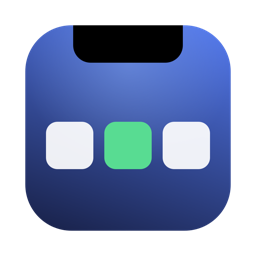

<p align="center">
  
</p>

<h1 align="center">Notchbench</h1>

<p align="center">A developer's workbench in your MacBook's notch.</p>

Notchbench turns the notch into a small dashboard. Hover over it to see your scheduled jobs, open ports,
clipboard history, quick notes and CPU / memory use, next to music controls, your calendar and a file shelf.

It's based on [Boring Notch](https://github.com/TheBoredTeam/boring.notch) by TheBoredTeam. See [Credits](#credits).

## Features

### New in Notchbench

- **Clipboard history**: recent text, links, images and Finder files. Click one to copy it again, then
  paste with ⌘V. Pin the ones you use often. Anything a password manager marks as private is never saved.
- **Jobs & Ports**
  - **Scheduled jobs**: your LaunchAgents (`~/Library/LaunchAgents`) and crontab, with readable schedules
    ("Daily 08:00, 16:00", "Mon–Fri 09:00", "Every 30 min"), next run time and status (running, failed,
    idle). Run, restart or stop a job, or open its log.
  - **Ports**: everything listening on a TCP port. Dev servers show the project they belong to
    (`node · my-api`). Open one in the browser or stop the process.
- **Notes**: quick notes you can type right in the notch. They're saved automatically.
- **System**: CPU and memory use with a 60-second graph, swap, and the apps using the most.

Each tab can be turned off in Settings.

### From Boring Notch

- Music controls with album art and a visualizer (Apple Music, Spotify, YouTube Music and any Now Playing source)
- Calendar events and reminders
- A file shelf: drop files on the notch and share them with AirDrop
- Volume, brightness and battery HUDs
- A camera mirror

## Requirements

- macOS 14 Sonoma or later
- Xcode 16 or later, to build it

## Install

Notchbench isn't signed with an Apple Developer ID yet, so you build it yourself. It takes one command:

```bash
git clone https://github.com/edincokic/notchbench.git
cd notchbench
./install-local.sh
```

The script builds a Release copy, installs it to `/Applications/Notchbench.app` and starts it.
Run it again after pulling new changes.

To work on the code, open `boringNotch.xcodeproj` in Xcode and run the `boringNotch` scheme.

## How it works

Notchbench runs in the macOS app sandbox. Jobs, ports and the busiest-apps list need to see other
processes, so that part runs in a small helper (`BoringNotchXPCHelper/`) that comes inside the app.
The helper only acts on agents in your own `~/Library/LaunchAgents`, and it only stops a process
that is listening on the port you picked.

Everything stays on your Mac. Clipboard history and notes are saved in the app's own sandbox folder.

## Contributing

Bug reports, ideas and pull requests are welcome. See [CONTRIBUTING.md](CONTRIBUTING.md).

## Credits

Notchbench is a modified version of **[Boring Notch](https://github.com/TheBoredTeam/boring.notch)**
by [TheBoredTeam](https://github.com/TheBoredTeam) and its contributors. Most of the app, including
the notch window, music, calendar, shelf and HUDs, is their work. Thank you!

**Changes made for Notchbench** (WakandaDev, November 2026):

- Added the Clipboard, Jobs & Ports, Notes and System tabs, and their settings pages
- Added jobs, ports and process requests to the XPC helper
- Let the notch take keyboard focus while you're typing a note
- Renamed the app and gave it a new icon and app ID
- Removed the Boring Notch update feed, release automation and sponsor links

Boring Notch's own credits: the Now Playing support uses
[MediaRemoteAdapter](https://github.com/ungive/mediaremote-adapter), and the first version of the Shelf
was based on [NotchDrop](https://github.com/Lakr233/NotchDrop). For all third-party licenses, see
[THIRD_PARTY_LICENSES](THIRD_PARTY_LICENSES).

## License

Notchbench is free software under the [GNU General Public License v3.0](LICENSE), the same license as
Boring Notch. You can use, change and share it, as long as your version stays under GPL-3.0 too.
